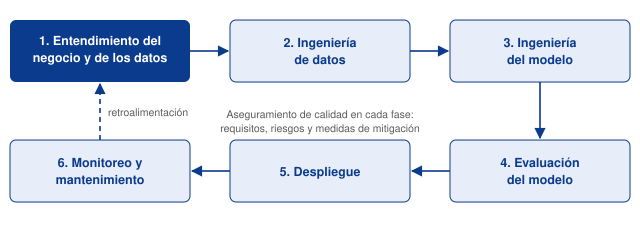
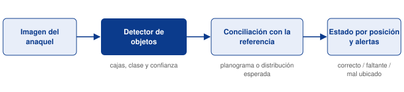

<div style="text-align: center;">

# Avance 0 | Propuesta de proyecto y firma de convenios

### Planograma: IA para detección de productos y ubicación

**Tecnológico de Monterrey** · Maestría en Inteligencia Artificial Aplicada<br>
**TC5035.10 — Proyecto Integrador (Grupo 10)**

**Equipo 48** · **Modalidad:** En equipo · **Fecha:** Septiembre 2026

| Integrante | Matrícula |
|---|---|
| Oscar Alberto Ramírez Anaya | A01795438 |
| Germán Eduardo Rodríguez Vázquez | A01796325 |
| Jesús Soto Medrano | A01794746 |

**Profesora:** Dra. Grettel Barceló Alonso · **Asesor:** Dr. Raúl Valente Ramírez<br>
**Sponsor:** Dr. Juan Arturo Nolazco Flores · **Organización:** Bnext

</div>

---

**Entregable:** [`Avance0.48.pdf`](./Avance0.48.pdf) · Fuente: [`Avance0.48.html`](./Avance0.48.html)

## Resumen

Propuesta del proyecto integrador, fase de **Entendimiento del negocio y de los datos** de CRISP-ML(Q).
A partir de una imagen de anaquel, el sistema debe **detectar y localizar los productos y los espacios
vacíos**, y determinar para cada posición si su estado es **correcto, faltante o mal ubicado** respecto al
planograma, para generar una **alerta de resurtido** cuando corresponda. El proyecto se desarrolla con
Bnext (Monterrey), empresa de tecnología para retail, en vinculación con el Hub de Ciencia de Datos del
Tecnológico de Monterrey y bajo un convenio de confidencialidad.

## Problema y contexto

El proceso impactado es la **ejecución en piso de venta**: el resurtido de anaquel y el cumplimiento del
planograma. Hoy ambos dependen de recorridos manuales, intermitentes y difíciles de escalar. El faltante
en anaquel tiene un costo directo: Gruen et al. (2002) estimaron una tasa promedio de faltantes de 8.3 %,
con 70–75 % de las causas originadas dentro de la propia tienda, y ante un faltante 31 % de los
consumidores compra en otra tienda y 9 % no compra.

## Metodología: CRISP-ML(Q)



*Fases de CRISP-ML(Q). Elaboración propia con base en Visengeriyeva et al. (2023) y Studer et al. (2021).*

## Objetivos

**General.** Desarrollar y evaluar un prototipo de visión computacional y aprendizaje profundo que, a
partir de imágenes de anaquel, detecte productos y espacios vacíos, determine el estado de cada posición
respecto al planograma y genere alertas de resurtido.

| Objetivo comercial | Objetivo del proyecto | Medición |
|---|---|---|
| Reducir el tiempo que un producto permanece agotado | Detectar espacios vacíos y emitir alertas por posición | Recall y precisión en posiciones faltantes |
| Asegurar que la exhibición respete el planograma | Identificar cada producto y compararlo con la posición prescrita | Exactitud del estado por posición |
| Disminuir el esfuerzo de verificación manual | Diagnosticar la imagen sin intervención humana | Tiempo por imagen y proporción que requiere revisión |
| Contar con un modelo confiable en distintas tiendas | Evaluar sobre imágenes no vistas | mAP@0.5 en prueba |

## Criterios de éxito y metas propuestas

| Nivel | Criterio | Meta |
|---|---|---|
| Aprendizaje automático | Precisión promedio de detección (mAP, IoU 0.5) | mAP@0.5 ≥ 0.80 |
| Aprendizaje automático | Sensibilidad en posiciones faltantes | Recall ≥ 0.90 |
| Aprendizaje automático | Precisión de las alertas de resurtido | Precisión ≥ 0.85 |
| Negocio | Exactitud del estado por posición | Exactitud ≥ 0.85 |
| Negocio | Tiempo de diagnóstico por imagen | 2 a 10 s con GPU |
| Económico | Costo de operación contra verificación manual y ventas perdidas | Por caracterizar con Bnext |

Las metas son una propuesta del equipo y se validarán con el sponsor y con Bnext tras el análisis
exploratorio.

## Preguntas clave

1. ¿Con qué desempeño es posible detectar productos y espacios vacíos en las imágenes reales de Bnext?
2. ¿Qué nivel de identificación es alcanzable con el etiquetado disponible: SKU, marca o categoría?
3. ¿Existe una representación del planograma asociada a las imágenes o debe construirse?
4. ¿Qué estrategia de etiquetado aprovecha un volumen cercano a 100 mil imágenes con esfuerzo acotado?
5. ¿Qué condiciones de captura degradan el desempeño y qué tan bien generaliza el modelo?
6. ¿Qué balance entre alertas falsas y faltantes no detectados es aceptable para la operación?
7. ¿Qué costo de cómputo y tiempo de respuesta son compatibles con el uso esperado?

## Involucrados

| Involucrado | Rol | Participación |
|---|---|---|
| Dr. Juan Arturo Nolazco Flores | Sponsor, Hub de Ciencia de Datos | Alta. Decisor: vinculación con Bnext, alcance y criterios de éxito |
| Líder técnico de Bnext | Proveedor de datos y validador | Alta. Acceso a los datos y validación técnica |
| Dr. Raúl Valente Ramírez | Asesor | Media. Orientación metodológica y técnica |
| Dra. Grettel Barceló Alonso | Profesora | Media. Seguimiento académico y evaluación |
| Equipo 48 | Equipo de desarrollo | Alta. Análisis, etiquetado, modelado, evaluación y documentación |

## Entendimiento inicial de los datos

Aproximadamente **100 mil imágenes** de anaqueles de punto de venta proporcionadas por Bnext, alojadas en
su infraestructura con acceso por VPN. Son datos no estructurados: qué producto hay, dónde está y dónde
falta está codificado en los píxeles. La técnica seleccionada es **aprendizaje profundo supervisado para
detección de objetos con transferencia de aprendizaje**, porque el problema exige localizar (no solo
reconocer), las escenas son densas y los resultados deben auditarse contra una referencia. Las
arquitecturas candidatas son YOLO y Faster R-CNN.

| Tipo | Variable | Descripción |
|---|---|---|
| Entrada | Imagen del anaquel | Matriz de píxeles RGB de la exhibición |
| Entrada auxiliar | Distribución de referencia | Planograma o distribución esperada del anaquel |
| Entrada auxiliar | Metadatos de captura | Tienda, fecha y anaquel, para particionar sin fuga |
| Salida del modelo | Detecciones | Caja, clase (SKU, categoría o vacío) y confianza |
| Salida de negocio | Estado por posición | Correcto, faltante o mal ubicado |
| Salida de negocio | Alerta de resurtido | Posiciones faltantes con su ubicación |



*Flujo propuesto: el detector localiza productos y vacíos; la conciliación compara con la distribución
esperada para obtener el estado de cada posición y las alertas de resurtido.*

## Convenios

El acceso a los datos está formalizado con un **convenio de confidencialidad (NDA)** firmado por los tres
integrantes. El convenio no se adjunta por su carácter confidencial; el sponsor y el asesor tienen
conocimiento de su firma. Reglas adoptadas:

- Las imágenes y el material de Bnext permanecen en el entorno provisto por la empresa.
- Ninguna imagen, planograma o identificador comercial se incorpora a repositorios públicos ni a los
  entregables sin autorización expresa.
- Los resultados se reportan de forma agregada o sobre ejemplos autorizados.
- Las credenciales son personales y no se registran en el código.

## Contenido del repositorio

| Archivo | Descripción |
|---|---|
| **`Avance0.48.pdf`** | Entregable (12 páginas) |
| `Avance0.48.html` | Fuente editable del documento |
| `figuras/` | Diagramas del documento (SVG) |
| `assets/print.css` | Hoja de estilo de impresión (A4) |
| `numerar_paginas.py` | Estampa el pie de página y los metadatos sobre el PDF |

## Regenerar el PDF

```bash
"/Applications/Google Chrome.app/Contents/MacOS/Google Chrome" \
  --headless --disable-gpu --no-pdf-header-footer \
  --print-to-pdf="Avance0.48.pdf" "file://$(pwd)/Avance0.48.html"
python3 numerar_paginas.py
```

## Referencias principales

- Gruen, T. W., Corsten, D. S., y Bharadwaj, S. (2002). *Retail out-of-stocks: A worldwide examination of extent, causes and consumer responses*. Grocery Manufacturers of America.
- Goldman, E., Herzig, R., Eisenschtat, A., Goldberger, J., y Hassner, T. (2019). Precise detection in densely packed scenes. *CVPR 2019*, 5222–5231.
- Studer, S., et al. (2021). Towards CRISP-ML(Q): A machine learning process model with quality assurance methodology. *Machine Learning and Knowledge Extraction, 3*(2), 392–413.
- Visengeriyeva, L., Kammer, A., Bär, I., Kniesz, A., y Plöd, M. (2023). *CRISP-ML(Q). The ML lifecycle process*. MLOps. INNOQ.

La bibliografía completa está en el PDF.
